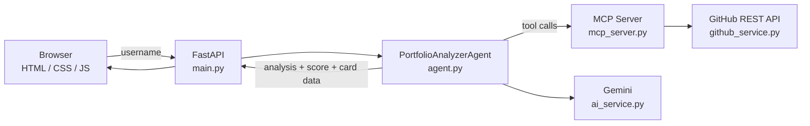

# AI-Powered GitHub Portfolio Analyzer 🚀

An agent-driven web app that turns any GitHub profile into an AI-analyzed portfolio dashboard and a downloadable developer card. It uses Google Gemini for analysis and the Model Context Protocol (MCP) to expose GitHub-scraping and scoring as tools the agent can call.

**🔗 Live demo:** https://ai-powered-github-portfolio-analyze.vercel.app


[Dashboard screenshot](docs/dashboard.png) 

## ✨ Features

- **🧠 Coding personality analysis:** Gemini reads a developer's repos, languages and activity and describes their coding style.
- **📊 Interactive dashboard:** Developer stats, a professional summary and skill charts in a responsive glassmorphism UI.
- **🪪 Downloadable portfolio card:** Export your card as an image or PDF.
- **🤖 Agentic workflow:** A `PortfolioAnalyzerAgent` orchestrates scraping, analysis, scoring and card generation.
- **🔌 MCP tools:** The GitHub and scoring logic is exposed as MCP tools via FastMCP.
- **🌓 Dark/light theme.**

## 🏗️ Architecture



### Agent workflow

1. **Scrape:** fetch user metadata, repos, languages and contribution stats with the `scrape_github` tool.
2. **Analyze:** Gemini determines coding personality and technical focus.
3. **Summarize:** generate a short professional bio based on the developer's strengths.
4. **Score:** compute a Developer Score from stars, forks and contribution consistency.
5. **Generate card:** combine the insights into a structured format for the UI.
6. **Save:** persist the analysis and prepare the downloadable assets.

## 🛠️ Tech stack

| Layer | Tools |
|---|---|
| Frontend | HTML5, CSS3, JavaScript (ES6+), Chart.js, html2canvas, jsPDF |
| Backend | FastAPI, FastMCP, Google Generative AI SDK, GitHub REST API |
| Infra | Docker, Docker Compose, Google Cloud Run (`deploy.sh`), Vercel (demo) |

## 🚀 Getting started

### Prerequisites

- Python 3.9+
- A [Google Gemini API key](https://aistudio.google.com/)
- A [GitHub personal access token](https://github.com/settings/tokens) (optional, but avoids low rate limits)
- Docker and Docker Compose (optional)

### 1. Clone and configure

```bash
git clone https://github.com/satwikgeddada/AI-Powered-GitHub-Portfolio-Analyzer.git
cd AI-Powered-GitHub-Portfolio-Analyzer
cp .env.example .env
```

Edit `.env`:

```env
GEMINI_API_KEY=your_gemini_api_key_here
GEMINI_MODEL=your_preferred_gemini_flash_model   # check Google's docs for currently supported model names
GITHUB_TOKEN=your_github_token_here               # optional, recommended
PORT=8000
```

> ⚠️ Never commit your `.env` file. Only `.env.example` belongs in the repo.

### 2a. Run with Docker (recommended)

```bash
docker-compose up --build
```

Open http://localhost:8000.

### 2b. Run locally

```bash
cd backend
python -m venv venv
source venv/bin/activate        # Windows: venv\Scripts\activate
pip install -r requirements.txt
python main.py
```

The frontend is served statically by FastAPI, so http://localhost:8000 is all you need.

## 📂 Project structure

```
AI-Powered-GitHub-Portfolio-Analyzer/
├── backend/
│   ├── agent.py            # Agent orchestration logic
│   ├── ai_service.py       # Gemini integration
│   ├── github_service.py   # GitHub API calls
│   ├── mcp_server.py       # MCP tool server
│   ├── main.py             # FastAPI entry point
│   └── static/             # Generated portfolio cards
├── frontend/
│   ├── index.html          # Dashboard UI
│   ├── app.js              # Frontend logic and charts
│   └── style.css           # Glassmorphism styling
├── docker-compose.yml
└── deploy.sh               # Cloud Run deployment script
```

## 🗺️ Roadmap

- [ ] Caching of GitHub API responses to reduce rate-limit hits
- [ ] Side-by-side comparison of two developers
- [ ] Unit tests for scoring logic and GitHub service
- [ ] GitHub Actions CI (lint + tests)
- [ ] Sample output and screenshots in `docs/`

## 💡 What I learned

- Structuring an LLM agent around explicit tools using MCP
- Handling third-party API rate limits and failures gracefully
- Containerizing a Python backend and deploying it to the cloud

## 🤝 Contributing

Issues and pull requests are welcome. For larger changes, please open an issue first to discuss what you'd like to change.

## 📄 License

MIT. See the [LICENSE](LICENSE) file.

## 👤 Author

**Satwik Geddada**:
- 🌐 Portfolio: [satwik-geddada-portfolio.vercel.app](https://satwik-geddada-portfolio.vercel.app/)
- 💻 GitHub: [@satwikgeddada](https://github.com/satwikgeddada)
- 💼 LinkedIn: [satwik-geddada](https://www.linkedin.com/in/satwik-geddada-72bb172b9)
